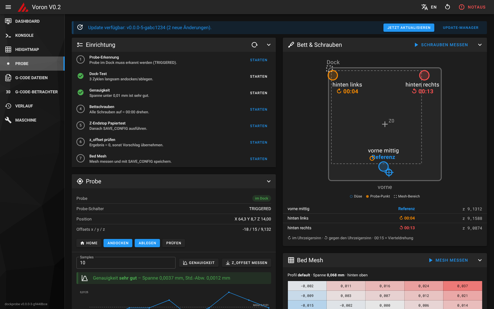

# VoronV0-Zeroclick-Mainsail-UI (voron0-dockprobe)

*Deutsche Version: [README.md](README.md)*



Dock probe kit for the **Voron V0.2** with the Z endstop at the bottom and a magnetically docked probe (e.g. ZeroClick).
One script analyses your Klipper config, calculates mesh and screw positions from the probe offsets and sets everything up:

- macros for attaching/docking with verification via the probe pin
- automatic probe handling for `BED_MESH_CALIBRATE`, `SCREWS_TILT_CALCULATE`, `PROBE_ACCURACY`
- `CALIBRATE_ALL`: home, heat, screw check and mesh in one run
- `CALIBRATE_Z_ENDSTOP` (paper test) and `MEASURE_PROBE_OFFSET`
- calibration UI as its own **“Probe”** entry in the Mainsail sidebar: setup checklist, dock test, accuracy chart,
  live bed view, mesh profiles and a settings editor – rendered with Mainsail's own styles and your active theme
- updates via the Mainsail update manager

> **Principle:** Z=0 still comes from the Z endstop. The probe only measures relative heights (mesh, screws).
> `zero_reference_position` normalises the mesh to 0 at the paper-test point.

## Requirements

- Klipper + Moonraker + Mainsail (KIAUH or MainsailOS)
- Dock at the rear left; attaching from right to left, releasing with a Y move
- Probe pin configured so that `QUERY_PROBE` reports **TRIGGERED with the probe docked** and **open on the toolhead**
  (NC switches usually `^PIN` without `!`)

## Installation

```bash
cd ~
git clone https://github.com/Screase3D/VoronV0-Zeroclick-Mainsail-UI.git
cd VoronV0-Zeroclick-Mainsail-UI
./install.sh --lang en
```

The script analyses the config, asks for pin, offsets, dock and screw positions (suggestions from your existing config),
calculates `mesh_min/max`, screw probe points, `horizontal_move_z` and the reference point, shows all planned changes,
backs up the config folder to `~/dockprobe-backups/`, installs and restarts Klipper.

| Option | Effect |
|---|---|
| `--analyze` | analysis only, changes nothing |
| `--dry-run` | show every step, change nothing |
| `--reconfigure` | ask for values again, regenerate `probe_dock_settings.cfg` |
| `--no-web` | without the web UI |
| `--no-restart` | do not restart Klipper |
| `--yes` | accept all suggestions |
| `--lang de\|en` | language of the installer and Klipper messages |

Existing `[probe]`, `[bed_mesh]`, `[screws_tilt_adjust]` sections and dock/mesh macros are commented out with `#dockprobe# `,
KAMP `Adaptive_Meshing.cfg` is disabled (Klipper does `ADAPTIVE=1` itself). If `z_offset` lives in the SAVE_CONFIG block it stays there.

## First calibration

1. `PROBE_STATUS` – docked probe must be detected
2. `CALIBRATE_Z_ENDSTOP` – paper test, `ACCEPT`, `SAVE_CONFIG`
3. `MEASURE_PROBE_OFFSET` – result ≈ 0, otherwise `z_offset` = old value + reported z
4. `PROBE_ACCURACY SAMPLES=10` – range < 0.01 mm is very good
5. `CALIBRATE_ALL BED=60 SOAK=10`

Repeat step 2 after every turn of a bed screw. `PROBE_CALIBRATE` is locked on purpose: the probe hangs several mm below the nozzle.

## Language

- **Installer:** asks at start (or `--lang de|en`).
- **Web UI:** follows Mainsail's/the browser's language; switch with **DE/EN** in the top bar.
- **Klipper macro messages:** `variable_lang` in `probe_dock_settings.cfg` (`"de"` or `"en"`), also in the UI under *Settings → Probe*.

## Web UI

The page loads the stylesheets of your installed Mainsail at runtime and uses the same building blocks, so it follows your
Mainsail theme, primary/logo colour, light/dark mode and everything in `config/.theme/` (`custom.css`, logos, backgrounds, `navi.json`).
The paper test opens as a dialog like in Mainsail and can be driven with the keyboard (↑/↓, Shift, PgUp/PgDn).

## Update & uninstall

The installer registers the repo in `moonraker.conf` (`[update_manager voron0-dockprobe]`, `type: git_repo`, `managed_services: klipper`).
New versions on GitHub appear in Mainsail under *Machine → Update Manager* and as a notice on the Probe page.
Macros and web UI update immediately, Klipper restarts automatically, and your `probe_dock_settings.cfg` is never touched.
If an update adds new settings fields, the Probe page tells you – saving once under *Settings* adds them.
Requires a `git clone` install without local changes in the repo folder.

`./uninstall.sh` removes includes, symlink, nginx entry, menu entry and update manager and optionally restores commented-out sections.

## Safety

Test the first dock moves at reduced speed with a hand on the emergency stop.

## License

MIT
