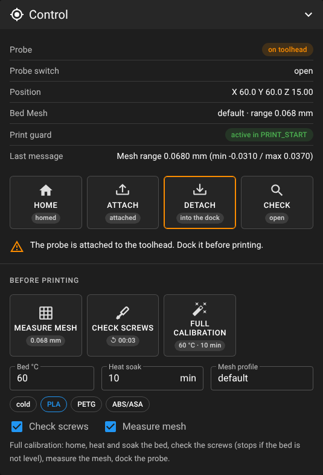
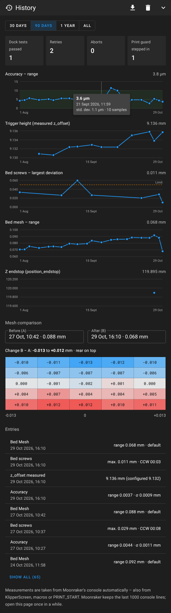
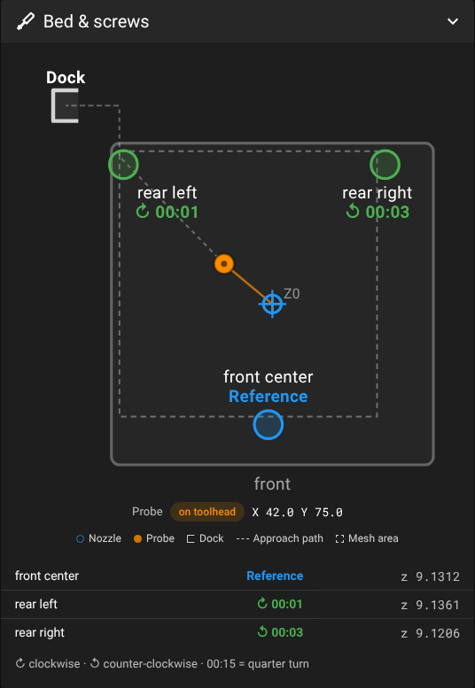
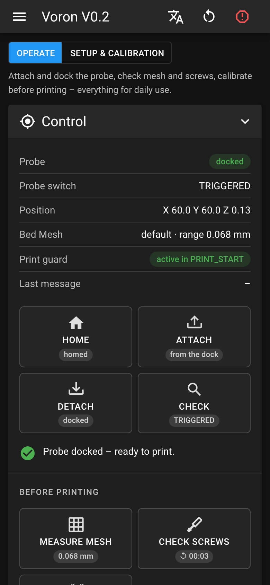
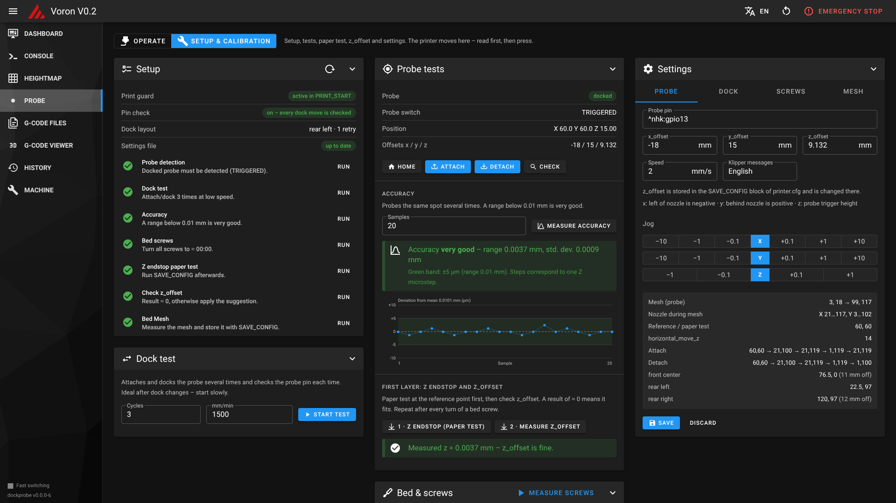
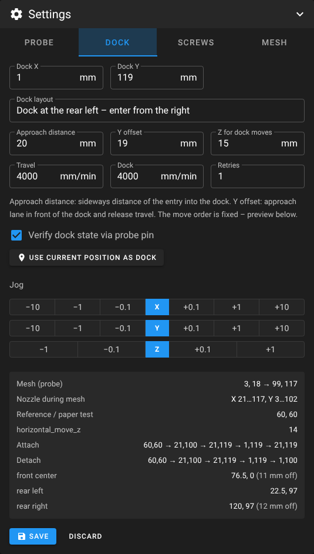
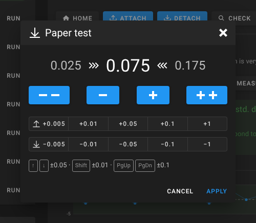
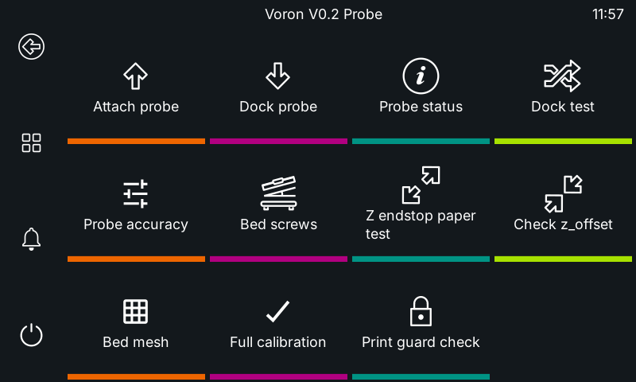
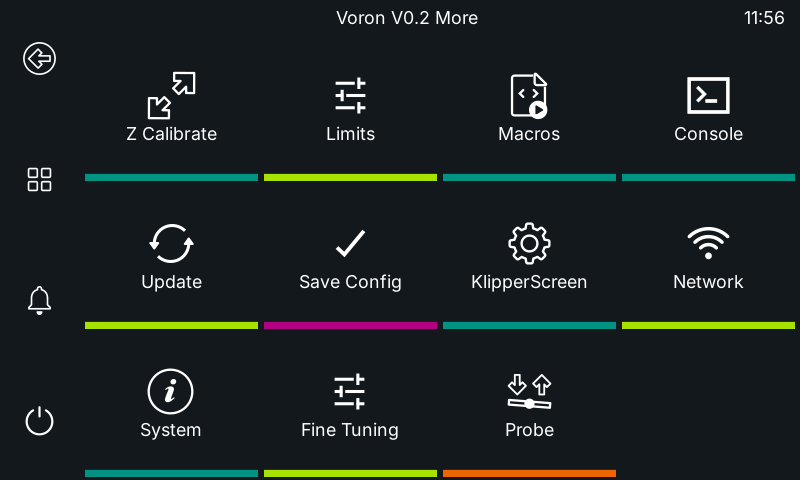
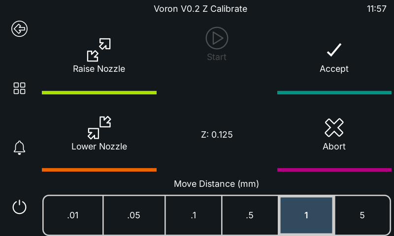

# VoronV0-Zeroclick-Mainsail-UI

> [!NOTE]
> **This repository was written by Claude Opus 5.5**, Anthropic's AI model – code, macros, installer, web UI and
> documentation. Review the macros before using them on your printer and run the first dock moves slowly.

**Dock probe kit for the Voron V0.2** – Klipper macros, a one-command installer and a calibration page that
plugs into Mainsail's sidebar. Built for a magnetically docked [ZeroClick](https://github.com/zruncho3d/ZeroClick)-style
probe on a printer that keeps its Z endstop.

[](LICENSE)


## Contents

- [Features](#features)
- [How it works](#how-it-works)
- [Requirements](#requirements)
- [Installation](#installation)
- [First calibration](#first-calibration)
- [The Probe page](#the-probe-page)
- [Macro reference](#macro-reference)
- [Settings reference](#settings-reference)
- [PRINT_START](#print_start)
- [KlipperScreen](#klipperscreen)
- [Updating](#updating)
- [Uninstalling](#uninstalling)
- [Troubleshooting](#troubleshooting)
- [Safety](#safety)
- [Credits](#credits)
- [License](#license)

## Features

- **Dock macros** – `ATTACH_PROBE` / `DETACH_PROBE` with state tracking and verification through the probe pin.
  If the pin shows that a pick-up or drop-off failed, the move is repeated once at half speed; if that fails too, the
  macro aborts with an error instead of carrying on with the probe in the wrong place.
- **Print guard** – `PROBE_GUARD` in `PRINT_START` reads the probe pin right before printing, docks a probe that is
  still attached and stops the print if that fails. The installer can add the line for you.
- **Other dock layouts** – the dock moves are waypoints relative to the dock: presets for a dock at the rear left
  (default), at the rear right, the ZeroClick README sample, or your own waypoints.
- **Automatic probe handling** – `BED_MESH_CALIBRATE`, `SCREWS_TILT_CALCULATE` and `PROBE_ACCURACY` fetch the probe
  and put it back on their own.
- **One-command calibration** – `CALIBRATE_ALL` homes, heat-soaks, checks the bed screws, meshes and docks the probe.
- **Safe z_offset workflow** – `CALIBRATE_Z_ENDSTOP` (paper test) and `MEASURE_PROBE_OFFSET` replace Klipper's
  `PROBE_CALIBRATE`, which would drive a hanging probe into the bed.
- **Installer** – analyses your config, calculates mesh bounds and screw points from the probe offsets, resolves
  conflicts (old macros, KAMP adaptive meshing), backs everything up and wires the UI into nginx, Mainsail and Moonraker.
- **Probe page in Mainsail** – two modes: **Operate** for everyday use (attach/dock, mesh, screws, full calibration,
  history) and **Setup & calibration** for the checklist, tests, paper test, z_offset and the settings editor.
  Rendered with Mainsail's own stylesheet and your theme.
- **History** – accuracy, measured z_offset, bed screws, mesh range and Z endstop as trend charts, a comparison of two
  meshes, dock statistics and CSV export. Runs started from KlipperScreen, macros or `PRINT_START` are included.
- **KlipperScreen menu (optional)** – the most important commands under *More → Probe*; removed again by the uninstaller.
- **Updates through Mainsail's update manager** – your settings are never overwritten.
- **English and German** – installer, web UI and Klipper messages.

## How it works

**Z = 0 still comes from the Z endstop.** The probe only measures *relative* heights (bed mesh, screw tilt).
`zero_reference_position` normalises every mesh to 0 at the point where you do the paper test, so the probe's
`z_offset` cannot shift your first layer.

**Dock sequence** (default layout: dock at the rear left, toolhead enters from the right). *d1* is the approach
distance beside the dock (default 20 mm), *d2* the Y offset of the approach lane and the release travel (default 19 mm):

| Step | Attach | Detach |
|---|---|---|
| 1 | lift to `safe_z`, move to the park point | same |
| 2 | approach lane: `dock_x + d1`, `dock_y − d2` | same |
| 3 | move to `dock_y` | same |
| 4 | move left to `dock_x` – the magnets couple | move left to `dock_x` – the probe sits in the dock |
| 5 | move back out to the right (`dock_x + d1`) | move forward to `dock_y − d2` – breaks the magnetic coupling |
| 6 | back to the park point, check the pin | back to the park point, check the pin |

The order of the moves is fixed – only the distances change. Internally every layout is a list of waypoints
`[dx, dy]` relative to `dock_x`/`dock_y`:

| Layout (`dock_layout`) | Attach waypoints | Detach waypoints |
|---|---|---|
| `right-front` – dock at the rear left, enter from the right (default) | `d1,−d2 · d1,0 · 0,0 · d1,0` | `d1,−d2 · d1,0 · 0,0 · 0,−d2` |
| `left-front` – dock at the rear right, enter from the left | `−d1,−d2 · −d1,0 · 0,0 · −d1,0` | `−d1,−d2 · −d1,0 · 0,0 · 0,−d2` |
| `zeroclick` – as in the ZeroClick README sample (center dock) | `−d1,−d2 · −d1,0 · 0,0` | `0,0 · −d1,0 · −d1,−d2` |
| `custom` – your own list | anything, one point must be `0,0` | anything, one point must be `0,0` |

Before and after the waypoints the toolhead goes to the park point at `safe_z`. Every waypoint is checked against
the travel range by the installer and the Settings panel.

**State tracking:** with a normally closed switch the probe pin reads `TRIGGERED` while the probe is in the dock
(circuit open) and `open` while it is attached. The macros check this after every move and on Klipper start-up.
If the pin shows the wrong state after a move, the whole move is repeated at half dock speed (`retries`, default 1);
only then does the macro abort. Set `verify: False` if your probe cannot tell the two states apart – then there are
no checks and no retries.

## Requirements

- Klipper, Moonraker and Mainsail installed with [KIAUH](https://github.com/dw-0/kiauh) or MainsailOS
  (nginx site called `mainsail`)
- Python 3 (standard library only) and `sudo` rights for the nginx step
- A dock that fits one of the [layouts](#how-it-works) or can be described with your own waypoints
- Probe pin configured so that `QUERY_PROBE` reports **TRIGGERED** with the probe **docked** and **open** with the
  probe **on the toolhead** (normally closed switches: usually `^PIN` without `!`)
- Moonraker must trust the browser (`trusted_clients`), as for Mainsail without login

**Tested with:** Voron V0.2 with Kirigami bed and Dragon Burner toolhead, ZeroClick-style probe with an NC microswitch,
BTT Pi (CB1), Klipper/Moonraker/Mainsail as of October 2026. The web UI was checked against Mainsail 2.19.

## Installation

```bash
cd ~
git clone https://github.com/Screase3D/VoronV0-Zeroclick-Mainsail-UI.git
cd VoronV0-Zeroclick-Mainsail-UI
./install.sh --dry-run      # shows every step, changes nothing
./install.sh                # the real installation
```

Run it as your normal user, not with `sudo` – it asks for `sudo` itself where needed. Don't install while printing.

**What the installer does**

1. Analyses the config: includes, travel range, Z endstop position, probe, conflicting sections and macros,
   KAMP, nginx and Moonraker.
2. Asks for pin, offsets, dock position and layout, retries, speeds and screw positions – suggestions come from
   your existing config.
3. Calculates `mesh_min`/`mesh_max`, the screw probe points, `horizontal_move_z` and the reference point,
   and warns about collisions or unreachable points.
4. Offers to add `PROBE_GUARD` to `PRINT_START` (default yes) and, if KlipperScreen is installed, the probe menu
   (default no).
5. Shows all planned changes and asks before touching anything.
6. Backs up the config folder (and the nginx site) to `~/dockprobe-backups/`.
7. Installs, adds the web UI to nginx (`nginx -t` first, reverted on failure) and restarts Klipper.

**Options**

| Option | Effect |
|---|---|
| `--analyze` | analysis only, changes nothing |
| `--dry-run` | show every step, change nothing |
| `--reconfigure` | ask for all values again and regenerate `probe_dock_settings.cfg` |
| `--lang en` / `--lang de` | language of the installer and the Klipper messages |
| `--yes`, `-y` | accept all suggestions without asking |
| `--no-web` | skip the web UI (nginx and Mainsail menu entry) |
| `--no-restart` | don't restart Klipper |
| `--no-guard` | don't offer to add `PROBE_GUARD` to `PRINT_START` |
| `--klipperscreen` / `--no-klipperscreen` | add the KlipperScreen menu without asking / never offer it |
| `--config-dir PATH` | Klipper config folder (default `~/printer_data/config`) |
| `--nginx-site PATH` | Mainsail's nginx site file |
| `--uninstall` | remove everything (same as `./uninstall.sh`) |

**Files that are changed**

| File | Change |
|---|---|
| `probe_dock.cfg` | symlink to `klipper/probe_dock.cfg` in the repo – the macro logic, updated with the repo |
| `probe_dock_settings.cfg` | your values – **never** overwritten by updates |
| `printer.cfg` | two `[include …]` lines; the `SAVE_CONFIG` block is left alone |
| existing `[probe]`, `[bed_mesh]`, `[screws_tilt_adjust]` and dock/mesh macros | commented out with `#dockprobe# ` (only inside the config folder) |
| `KAMP_Settings.cfg` | the `Adaptive_Meshing.cfg` include is commented out – Klipper does `ADAPTIVE=1` itself |
| `.theme/navi.json` | menu entry **Probe** (other entries are kept) |
| Mainsail's nginx site | `include /etc/nginx/snippets/dockprobe.conf;` |
| `moonraker.conf` | `[update_manager voron0-dockprobe]` |
| your `PRINT_START` / `START_PRINT` macro (on request) | one line `PROBE_GUARD  # dockprobe: …` after the last probing command, outside any `` block |
| `KlipperScreen.conf` (on request) | `[include dockprobe_klipperscreen.conf]` – a symlink to the menu file in the repo |

An existing single-file `probe_dock.cfg` is renamed to `probe_dock.cfg.old` and its values are offered as suggestions.
If `z_offset` lives in the `SAVE_CONFIG` block it stays there – a second copy in an included file would make every
`SAVE_CONFIG` fail.

## First calibration

Use the **Setup** checklist on the Probe page (mode *Setup & calibration*, opened automatically on a fresh install),
or the console:

1. `PROBE_STATUS` – the docked probe must be detected.
2. `DOCK_TEST CYCLES=3 F=1500` – attach and detach slowly, hand on the emergency stop.
3. `PROBE_ACCURACY SAMPLES=10` – a range below 0.01 mm is very good. If it is worse, lower the probe speed to 2 mm/s.
4. `SCREWS_TILT_CALCULATE` – turn the screws until all show ≈ 00:00.
5. `CALIBRATE_Z_ENDSTOP` – paper test, `ACCEPT`, `SAVE_CONFIG`.
6. `MEASURE_PROBE_OFFSET` – the result should be ≈ 0; otherwise new `z_offset` = current value + reported z
   (the Probe page offers an **Apply** button).
7. `BED_MESH_CALIBRATE` (or `CALIBRATE_ALL BED=60 SOAK=10`), then `SAVE_CONFIG`.

Repeat step 5 after every turn of a bed screw – the screws move the bed relative to the Z endstop.

## The Probe page

Open **Probe** in Mainsail's sidebar, or `http://<printer>/server/dockprobe/` (also served at `/probe/`).
The `/server/` path is deliberate: Mainsail's service worker does not intercept it, which matters when Mainsail is
accessed via https.

The page has two modes, switched at the top: **Operate** holds what you need day to day, **Setup & calibration**
everything you do once or after changes – the printer moves there, so read first, then press. The mode is
remembered per browser; a fresh install starts in *Setup & calibration*.

<table>
<tr>
<td width="34%"></td>
<td width="33%"></td>
<td width="33%"><br><br></td>
</tr>
</table>

**Operate**

| Panel | What it does |
|---|---|
| **Control** | probe state, switch, position, active mesh, print guard and the last message from the macros; tiles for **Home**, **Attach**, **Detach** and **Check** that show the current state and pulse while running; a hint with the next useful step (e.g. *dock the probe before printing*, or how far the setup is). **Before printing:** **Measure mesh**, **Check screws** and **Full calibration** (`CALIBRATE_ALL`) with bed temperature presets, heat-soak time, mesh profile and a summary of the steps before it starts |
| **Bed & screws** | live view of nozzle and probe (in the dock or on the toolhead), dock, approach path, mesh area and Z0 point; screw results with turn direction and the previous measurement |
| **Bed Mesh** | heat map of the active mesh; load, save and delete profiles |
| **History** | trend charts for accuracy, measured z_offset, largest screw deviation, mesh range and Z endstop position (hover or arrow keys for details); counters for dock tests, retries, aborts and print-guard interventions; comparison of two meshes as a difference map; list of all entries; CSV export; time range 30 days / 90 days / 1 year / all |



**Setup & calibration**

| Panel | What it does |
|---|---|
| **Setup** | status of the installation (print guard, pin check, dock layout and retries, settings file) and the calibration steps in the right order; steps tick themselves off after a successful measurement |
| **Probe tests** | state, pin, position and offsets; attach/detach; accuracy test with chart (deviation per sample in µm) and rating; Z endstop paper test and z_offset check with **Apply** |
| **Dock test** | `DOCK_TEST` with cycles and speed |
| **Bed & screws** | as above, with a **Measure screws** button for adjusting |
| **Settings** | offsets, pin, dock position and layout (presets or own waypoints), retries, screw positions, mesh and message language. Jog there and click to take over a position. Mesh bounds, probe points, reference point and the dock waypoints are recalculated live; saving shows a diff, keeps a `.bak` and restarts Klipper |

<table>
<tr>
<td width="50%"></td>
<td width="50%"></td>
</tr>
</table>

In both modes: the **Paper test** dialog opens automatically during `CALIBRATE_Z_ENDSTOP`, like Mainsail's (keyboard:
↑/↓ ±0.05, Shift ±0.01, PgUp/PgDn ±0.1), and the **Console** at the bottom takes G-code and shows the responses.

**Look and feel:** the page loads the stylesheets of your installed Mainsail at runtime and follows its theme
(e.g. *Voron Design*), primary and logo colour, light/dark mode, icons-only navigation and everything in
`config/.theme/` (`custom.css`, `sidebar-logo`, `sidebar-background`, `main-background`, `navi.json`).

**Fast switching:** the page preloads Mainsail invisibly. Clicking Dashboard, Console etc. just reveals it – no
re-initialisation – and **Probe** in Mainsail's menu switches straight back. Browser back/forward work. Turn it off with
*Fast switching* at the bottom of the sidebar or `?shell=0`.

**History:** the page reads Moonraker's console log (the last 1000 lines) and keeps every measurement in
Moonraker's database (namespace `dockprobe`), so all browsers see the same history. Measurements from KlipperScreen,
macros or `PRINT_START` are picked up too, as long as the page is opened before they scroll out of the log. The
trash button in the panel deletes the history.

**Language:** follows Mainsail or the browser; switch with the **EN/DE** button in the top bar, which also changes
the language of the Klipper messages.

## Macro reference

| Command | Description |
|---|---|
| `ATTACH_PROBE [FORCE=1] [F=<mm/min>]` | Pick up the probe. Skipped if already attached unless `FORCE=1`. `F` overrides all XY speeds, e.g. for slow first tests. If the pin check fails, the move is repeated at half speed (`retries`) before it aborts. |
| `DETACH_PROBE [FORCE=1] [F=<mm/min>]` | Put the probe back into the dock – same check and retry. |
| `PROBE_GUARD` | For `PRINT_START`: reads the probe pin; docks the probe if it is still attached; aborts (and with it the print) if docking fails. Without `verify` it uses the stored state. |
| `PROBE_STATUS` | Run `QUERY_PROBE` and sync the stored state with the pin. |
| `DOCK_TEST [CYCLES=3] [F=<mm/min>]` | Attach and detach repeatedly; every move is verified. |
| `BED_MESH_CALIBRATE [...]` | Klipper's command with automatic attach; detaches only if it attached the probe itself. All parameters (e.g. `ADAPTIVE=1`, `PROFILE=`) are passed through. Prints one line with the mesh range afterwards. |
| `SCREWS_TILT_CALCULATE [...]` | Same wrapper for the bed screw check. |
| `PROBE_ACCURACY [...]` | Same wrapper, measured at the reference point. |
| `MEASURE_PROBE_OFFSET` | Probe at the reference point. The reported z is the correction for `z_offset` (≈ 0 means it fits). |
| `CALIBRATE_Z_ENDSTOP` | Dock the probe, move to the reference point, start Klipper's `Z_ENDSTOP_CALIBRATE`. |
| `CALIBRATE_ALL [BED=0] [SOAK=0] [SCREWS=1] [MESH=1] [PROFILE=default] [SAVE=0]` | Home; with `BED` > 0 heat the bed, soak for `SOAK` minutes and re-home Z; check the screws (stops before meshing above `max_screw_dev`); mesh into `PROFILE`; dock; optionally `SAVE_CONFIG`. |
| `PROBE_CALIBRATE` | Locked on purpose – the probe hangs several mm below the nozzle. |

## Settings reference

Everything you can change lives in `probe_dock_settings.cfg` (or in the **Settings** panel).

`[gcode_macro _PROBE_VARS]`

| Variable | Meaning | Default |
|---|---|---|
| `dock_x`, `dock_y` | nozzle position at which the probe sits in the dock | 1, 119 |
| `dock_layout` | name of the preset the paths were made from: `right-front`, `left-front`, `zeroclick` or `custom` | `right-front` |
| `attach_path`, `detach_path` | waypoints `[[dx, dy], …]` relative to `dock_x`/`dock_y`, in move order; one of them `[0, 0]` | see [layouts](#how-it-works) |
| `retries` | extra attempts at half dock speed when the pin check after a dock move fails (0 = abort immediately) | 1 |
| `safe_x`, `safe_y` | park position = `zero_reference_position` = paper-test point (calculated) | bed centre |
| `safe_z` | Z height for all dock moves – must clear the probe tip | max(14, `z_offset` + 5) |
| `travel_f`, `dock_f`, `z_f` | speeds in mm/min | 4000, 4000, 600 |
| `max_screw_dev` | largest screw deviation (mm) before `CALIBRATE_ALL` stops before meshing | 0.05 |
| `verify` | check the dock state via the probe pin | True |
| `lang` | language of the Klipper messages: `"en"` or `"de"` | installer language |

**Calculated by the installer and the Settings panel**

| Value | Rule |
|---|---|
| `mesh_min` / `mesh_max` | the area the probe can reach (travel range shifted by the offsets) minus an edge margin (default 3 mm) |
| `zero_reference_position` | bed centre, clamped into the area the nozzle covers while meshing |
| `horizontal_move_z` | `z_offset + 4`, at least 10 – keeps the hanging probe off the bed |
| screw points | nozzle position = screw position − probe offset, clamped to the travel range; a warning appears if the probe lands more than 15 mm from a screw |

Screw positions are entered as *the nozzle position when the nozzle is exactly above the screw*.

Settings files from older versions (with `approach_dx`/`staging_y` instead of the paths) keep working unchanged – the
macros derive the original sequence from them. Saving once in the **Settings** panel or `./install.sh --reconfigure`
converts the file.

## PRINT_START

```ini
[gcode_macro PRINT_START]
gcode:
  
  
  G28
  M190 S{target_bed}
  BED_MESH_CLEAR
  BED_MESH_CALIBRATE ADAPTIVE=1   # attaches and detaches the probe itself
  PROBE_GUARD                     # probe must be in the dock – docks it or stops the print
  M109 S{target_extruder}
  # purge line, e.g. LINE_PURGE from KAMP
```

`ADAPTIVE=1` needs `[exclude_object]` in `printer.cfg` and *Label objects* in the slicer. Mesh with a cold nozzle so
nothing oozes onto the bed.

`PROBE_GUARD` reads the pin itself instead of trusting the stored state, so it also catches a probe that was attached
by hand or left on the toolhead after an aborted macro. The installer inserts it after the last probing command of
your `PRINT_START` (or `START_PRINT`) if you agree; the Probe page shows whether it is there. Klipper cannot poll the
probe pin *during* a print without stalling the motion queue, so the check runs once, right before the print starts.

## KlipperScreen

If KlipperScreen is installed, the installer offers a **Probe** menu under *More*:



<table>
<tr>
<td width="50%"><br><sub><i>More</i> → <b>Probe</b></sub></td>
<td width="50%"><br><sub><b>Z endstop paper test</b> opens KlipperScreen's own <i>Z Calibrate</i> panel</sub></td>
</tr>
</table>

| Button | Command |
|---|---|
| Attach probe / Dock probe | `ATTACH_PROBE` / `DETACH_PROBE` |
| Probe status | `PROBE_STATUS` |
| Dock test | `DOCK_TEST CYCLES=3 F=1500` (asks first) |
| Probe accuracy | `PROBE_ACCURACY SAMPLES=10` |
| Bed screws | `SCREWS_TILT_CALCULATE` |
| Z endstop paper test | `CALIBRATE_Z_ENDSTOP` – KlipperScreen opens its *Z Calibrate* panel for the paper test |
| Check z_offset | `MEASURE_PROBE_OFFSET` |
| Bed mesh | `BED_MESH_CALIBRATE` (asks first) |
| Full calibration | `CALIBRATE_ALL BED=60 SOAK=10` (asks first) |
| Print guard check | `PROBE_GUARD` |

The menu only appears while the dockprobe macros are loaded. It is fully reversible: the installer adds one line,
`[include dockprobe_klipperscreen.conf]`, at the top of `KlipperScreen.conf` and a symlink to
`klipperscreen/dockprobe_<lang>.conf` in the repo – nothing else in your KlipperScreen setup changes. The uninstaller
removes both (and `KlipperScreen.conf` itself if the installer had to create it). Add it later with
`./install.sh --klipperscreen`. The menu language follows the Klipper messages; after switching the language, run
`./install.sh` once more and restart KlipperScreen.

## Updating

The installer registers the repo with Moonraker:

```ini
[update_manager voron0-dockprobe]
type: git_repo
channel: dev
path: ~/VoronV0-Zeroclick-Mainsail-UI
origin: https://github.com/Screase3D/VoronV0-Zeroclick-Mainsail-UI.git
primary_branch: main
managed_services: klipper
info_tags:
    desc=ZeroClick Dock-Probe (Voron V0.2)
```

New versions appear in Mainsail under **Machine → Update Manager** and as a notice on the Probe page.

- Macros and web UI are current right after the update; Klipper restarts automatically.
- `probe_dock_settings.cfg` is never touched. If an update adds settings fields, the Probe page says so – saving once
  under **Settings** adds them.
- Changes to nginx or the menu entry are not applied by updates. Run `./install.sh` again and answer *no* when asked
  to regenerate the settings.
- Requires a `git clone` install without local changes in the repo folder (otherwise Moonraker reports it as *dirty*).

To change your values from the shell: `./install.sh --reconfigure`.

## Uninstalling

```bash
cd ~/VoronV0-Zeroclick-Mainsail-UI
./uninstall.sh
```

Removes the includes, the symlink, the `PROBE_GUARD` line it added, the KlipperScreen menu, the nginx entry, the menu
entry and the update manager section, and – on request – restores the sections the installer commented out.
`probe_dock_settings.cfg` is kept unless you choose to delete it. Backups stay in `~/dockprobe-backups/`; delete them
and the repo folder by hand. The history stays in Moonraker's database – clear it in the History panel before
uninstalling if you want it gone.

## Troubleshooting

| Symptom | Cause and fix |
|---|---|
| *"Probe was not picked up – check the dock"* although it is attached | Pin logic inverted. Toggle the `!` in `pin:`. Check with `QUERY_PROBE`: docked → TRIGGERED, attached → open, attached and pressed → TRIGGERED. |
| *"retrying slowly"* shows up often | The first attempt keeps failing: check the dock position (`dock_x`/`dock_y`) with `DOCK_TEST F=1500`, the magnets and whether the dock moved. The History panel counts the retries. |
| The print stops with *"Probe is still attached to the toolhead"* | `PROBE_GUARD` could not dock the probe. Check the dock, then `PROBE_STATUS`. |
| The History panel stays empty | Measurements are read from Moonraker's console log. Run one (e.g. `PROBE_ACCURACY`) with the page open, or open the page more often than every ~1000 console lines. |
| The probe scrapes or crashes into the bed while meshing | `horizontal_move_z` / `safe_z` below the probe tip. Run `MEASURE_PROBE_OFFSET`, correct `z_offset` and save the settings again – the heights are recalculated. |
| Poor accuracy (range > 0.025 mm) | Probe too fast – use 2 mm/s. Check the magnets, the mount and the switch for play. |
| `SAVE_CONFIG` fails with an option defined twice | `z_offset` is in both `probe_dock_settings.cfg` and the `SAVE_CONFIG` block. Keep only one. |
| Two `BED_MESH_CALIBRATE` overrides | KAMP's `Adaptive_Meshing.cfg` or an old macro is still included. Run `./install.sh --analyze`. |
| Probe page shows Mainsail or a 404 | Use `/server/dockprobe/`; run `./install.sh` again; check that the nginx site contains the `dockprobe.conf` include. |
| *"voron0-dockprobe macros were not found"* | The `[include probe_dock*.cfg]` lines are missing in `printer.cfg`. |
| Update Manager shows *dirty* | Files in the repo folder were edited. Use **Recover** in the Update Manager. |
| nginx returns 403 for the page | nginx cannot enter your home folder: `chmod o+x ~`. |

## Safety

- Do the first dock moves slowly (`DOCK_TEST F=1500`) with a hand on the emergency stop – especially after changing
  offsets or dock coordinates.
- Never use Klipper's `PROBE_CALIBRATE` with a hanging probe – it is locked for a reason.
- After every turn of a bed screw, redo the Z endstop paper test.

## Credits

| Project | Author | Relation |
|---|---|---|
| [ZeroClick](https://github.com/zruncho3d/ZeroClick) | Zruncho | the probe and dock this kit is built for; the attach/detach sequence is based on its sample macros |
| [Klicky Probe](https://github.com/jlas1/Klicky-Probe) | jlas1 and contributors | pioneered the dockable-probe workflow that inspired ZeroClick |
| [Voron V0](https://github.com/VoronDesign/Voron-0) | Voron Design | the printer |
| [Kirigami bed](https://github.com/christophmuellerorg/voron_0_kirigami_bed) | Christoph Müller | the default screw positions were measured on it |
| [Klipper](https://github.com/Klipper3d/klipper) | Kevin O'Connor and contributors | firmware |
| [Moonraker](https://github.com/Arksine/moonraker) | Eric Callahan (Arksine) | API and update manager |
| [Mainsail](https://github.com/mainsail-crew/mainsail) | mainsail-crew | web interface whose look this page adopts |
| [Vuetify](https://github.com/vuetifyjs/vuetify) | Vuetify team | component framework behind Mainsail's styles |
| [Material Design Icons](https://pictogrammers.com/library/mdi/) | Pictogrammers | icons |
| [KAMP](https://github.com/kyleisah/Klipper-Adaptive-Meshing-Purging) | kyleisah | `LINE_PURGE` works alongside this kit |

This project is not affiliated with or endorsed by any of the projects above.

## License

Copyright © 2026 [Screase3D](https://github.com/Screase3D)

Licensed under the **GNU General Public License v3.0 or later** – see [LICENSE](LICENSE).
GPL-3.0 matches the Klipper ecosystem and the projects this kit builds on: the attach/detach sequence derives from the
ZeroClick sample macros (GPL-3.0) and the web UI mirrors a few Mainsail component styles (GPL-3.0).

Third-party material and its licenses are listed in [THIRD_PARTY_NOTICES.md](THIRD_PARTY_NOTICES.md):

| Component | License |
|---|---|
| Material Design Icons (SVG paths embedded in `web/index.html`) | Apache-2.0 – [LICENSES/Apache-2.0.txt](LICENSES/Apache-2.0.txt) |
| ZeroClick sample macros (basis of `ATTACH_PROBE` / `DETACH_PROBE`) | GPL-3.0 |
| Mainsail component styles (mirrored in `web/index.html`) | GPL-3.0 |
| Klipper, Moonraker, Mainsail (used at runtime, not included) | GPL-3.0 |
| Vuetify (part of Mainsail's stylesheet, not included) | MIT |
